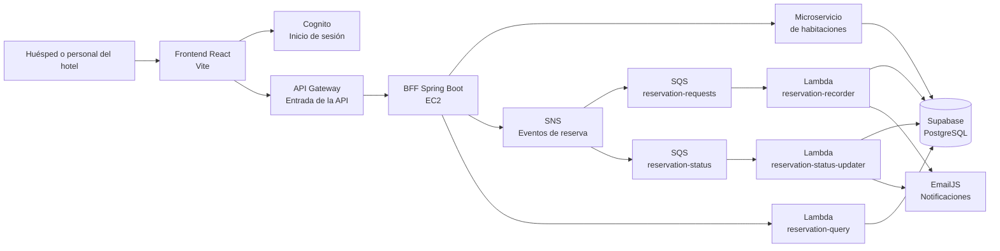

# Hotel Boutique 360

> Una experiencia sencilla para descubrir habitaciones, gestionar reservas y centralizar la operación de un hotel boutique.

## Presentación

Hotel Boutique 360 es una aplicación web pensada para reunir, en un solo lugar, la experiencia del huésped y las tareas habituales de recepción. Desde el catálogo se pueden consultar las habitaciones disponibles y solicitar una reserva; el personal autorizado puede administrar habitaciones, revisar reservas y actualizar su estado.

El proyecto está construido como una solución cloud-native: cada parte cumple una función concreta y los procesos que no necesitan una respuesta inmediata se ejecutan en segundo plano. Así, la persona recibe una confirmación rápida mientras AWS se encarga de completar el registro, actualizar la disponibilidad y enviar las notificaciones.

### Arquitectura de la solución



### El proyecto

- **El frontend** es la parte visible: catálogo, acceso, reservas, panel de operación y reportes.
- **Cognito** comprueba quién está entrando y permite diferenciar las funciones de un huésped y del personal del hotel.
- **API Gateway** es la puerta de entrada pública. Recibe las solicitudes y las dirige al sistema.
- **El BFF** coordina las operaciones: valida la sesión, consulta habitaciones y envía los eventos de reserva.
- **SNS y SQS** forman una cola de trabajo. Las reservas no dependen de que todas las tareas terminen al mismo tiempo.
- **Las Lambdas** procesan las reservas, actualizan estados y consultan la información guardada.
- **Supabase** conserva los datos y **EmailJS** se ocupa de los avisos por correo.

### Recorridos principales

#### Consultar habitaciones

```text
Frontend → API Gateway → BFF → servicio de habitaciones → Supabase
```

#### Crear una reserva

```text
Frontend → API Gateway → BFF → SNS → SQS → reservation-recorder
                                              ├─ Supabase
                                              └─ EmailJS
```

El BFF responde con `202 Accepted` cuando la solicitud quedó encolada. La reserva termina de registrarse unos segundos después.

#### Cambiar el estado de una reserva

```text
Frontend → API Gateway → BFF → SNS → SQS → reservation-status-updater
                                              ├─ Supabase
                                              └─ EmailJS
```

#### Consultar reservas

```text
Frontend → API Gateway → BFF → reservation-query → Supabase
```

## Despliegue y operación

### Qué se automatizó en GitHub

Cada repositorio conserva su propio código y workflow. Cuando se actualiza la rama principal:

1. GitHub Actions instala las dependencias y ejecuta la compilación.
2. El frontend genera sus archivos estáticos para publicación.
3. Las aplicaciones Java se empaquetan como JAR y como imagen Docker.
4. La imagen del BFF y del microservicio se publica en GitHub Container Registry.
5. El workflow se conecta a EC2 por SSH, reemplaza el contenedor anterior y levanta la nueva versión.
6. Las variables sensibles se entregan desde GitHub Secrets; no se guardan en el código.

### Qué se configuró en AWS

- **Amazon Cognito:** usuarios, inicio de sesión y grupos de acceso.
- **API Gateway HTTP API:** punto de entrada para el frontend y configuración CORS.
- **Amazon EC2:** ejecución del BFF y del microservicio mediante Docker.
- **Amazon SNS:** publicación de eventos `reservation.requested` y `reservation.status-changed`.
- **Amazon SQS:** colas que desacoplan el registro y la actualización de reservas.
- **AWS Lambda:** procesamiento asíncrono y consultas de reservas.
- **IAM/LabRole:** permisos de la EC2 y de las funciones para comunicarse con AWS.
- **Supabase PostgreSQL:** almacenamiento de habitaciones y reservas.

El frontend puede servirse como una aplicación estática en Vercel o mediante S3 + CloudFront. La guía de este repositorio documenta el despliegue con S3 + CloudFront; en ambos casos el frontend utiliza la URL pública de API Gateway.

### Resultado

La solución separa la experiencia de usuario de los procesos internos del hotel. El huésped recibe una respuesta clara, el personal trabaja con una interfaz centralizada y las tareas de persistencia y notificación se ejecutan de forma independiente y trazable en AWS.

---

## Referencia técnica

La siguiente sección conserva los detalles necesarios para configurar el entorno, comprender la seguridad y repetir el despliegue.

## 1. Objetivo

Construir una aplicación cloud native funcional y segura que permita:

- Iniciar y cerrar sesión con Cognito.
- Obtener tokens mediante Authorization Code con PKCE.
- Leer los claims del token, incluyendo grupos o roles.
- Consultar el estado del backend mediante `/health`.
- Consultar y administrar habitaciones mediante el CRUD del backend.
- Proteger las operaciones administrativas con el rol `ADMIN`.
- Ejecutar el backend en EC2 mediante Docker y GitHub Actions.
- Persistir la información en Supabase PostgreSQL.

## 2. Tecnologías

### Frontend

- React 19.
- TypeScript.
- Vite.
- `react-oidc-context` y `oidc-client-ts` para OIDC.
- Axios para consumir el API Gateway.
- `lucide-react` para iconos.

### Backend

- Java 21.
- Spring Boot.
- Spring Security.
- OAuth2 Resource Server con JWT.
- Spring Data JPA.
- PostgreSQL mediante Supabase.
- Docker.

### Nube y entrega

- Amazon Cognito como proveedor de identidad.
- AWS API Gateway como API Manager.
- Amazon EC2 para ejecutar el backend.
- Amazon SNS y SQS para procesar reservas de forma asíncrona.
- AWS Lambda para registrar, consultar y actualizar reservas.
- Supabase como base de datos PostgreSQL.
- GitHub Container Registry para publicar la imagen Docker.
- GitHub Actions para compilar, publicar y desplegar.


## Gracias por dedicar tiempo a leer!